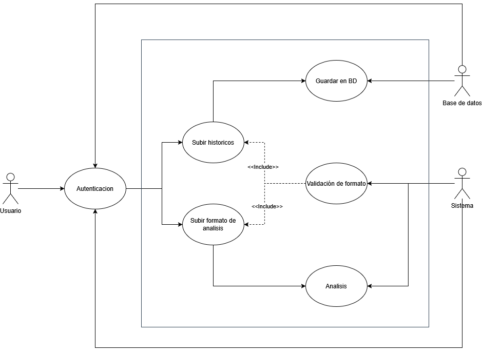
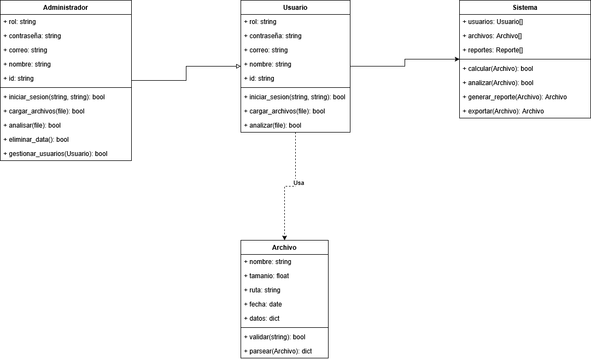
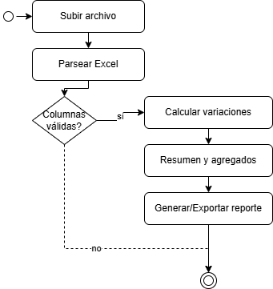
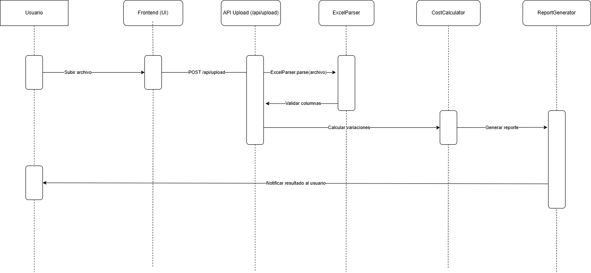

# Standard Costing App — English Documentation (clean copy)

Overview
--------
This repository contains an academic web application demonstrating a Standard Costing system. The app reads material
and production data from Excel files, validates and parses the data, computes standard costs and variances (price and
quantity), and exposes results via REST endpoints and frontend visualizations.

Quick start (Windows)
---------------------
1. Clone the repository and install backend dependencies:

```powershell
git clone <repo_url>
cd app-costeos#\backend
npm install
cd ..
```

2. Start the server (default port 3000):

```powershell
npm start
```

3. Open the app in your browser:

http://localhost:3000

Project layout
--------------
- `frontend/` — UI pages, CSS and client JS.
- `backend/` — Express server components:
  - `server.js` — application entry point.
  - `routes/` — API routes (`auth.js`, `upload.js`, `reports.js`).
  - `controllers/` — `costingController.js`, `variationController.js`.
  - `utils/` — `excelParser.js`, `formulas.js`.
- `uploads/` — temporary uploaded Excel files.
- `documentacion/` — academic documentation and diagrams.

Excel upload — flow and validation
---------------------------------
Upload and validation responsibilities are split between the frontend and `backend/utils/excelParser.js`:

- The UI sends a multipart upload to `POST /api/upload`.
- `multer` stores the file to `uploads/`.
- `backend/utils/excelParser.js` reads the sheet, validates required columns and numeric values, and normalizes the rows.

Use case — Excel upload (illustrative)


Class diagram — data structures (illustrative)


Cost processing — detailed flow
-------------------------------
Processing maps to `controllers/costingController.js` and `utils/formulas.js`:

- Validation & normalization (parser) → controller receives clean input.
- Per-record calculation (`utils/formulas.js`) → returns `costo_estandar`, `costo_real`, `variacion_precio`, `variacion_cantidad`.
- Aggregation & chart data preparation (`controllers/variationController.js`).

Activity flow — processing costs (illustrative)


Sequence — front → server → calculations (illustrative)


Visualization
-------------
Frontend scripts in `frontend/js/charts.js` consume the prepared JSON and render charts (Chart.js) and data tables for
per-material and summary analysis.

API Endpoints (expected)
------------------------
- `POST /api/auth/login` — demo authentication using `data/users.json`.
- `POST /api/upload` — upload Excel file (multipart/form-data).
- `POST /api/costing/calculate` — process data and compute results.
- `GET /api/reports` — return generated report data.

Excel input requirements
------------------------
Required columns (snake_case):

- `material`
- `ps` (standard price)
- `qs` (standard quantity per unit)
- `precio_real` (price actually paid)
- `cantidad_real` (quantity actually used)
- `unidades_producidas`

Calculation summary (see `backend/utils/formulas.js`)
--------------------------------------------------
- Standard cost = `ps * qs * unidades_producidas`.
- Real cost = `precio_real * cantidad_real * unidades_producidas`.
- Total variance = `costo_real - costo_estandar`.
- Price variance = `(precio_real - ps) * cantidad_real`.
- Quantity variance = `(cantidad_real - qs) * ps`.

Documentation and diagrams
--------------------------
All documentation is in the `documentacion/` folder:

- Requirements: [documentacion/Requerimientos de documentacion.md](documentacion/Requerimientos%20de%20documentacion.md)
- Excel guidance: [documentacion/EXCEL-EJEMPLO.md](documentacion/EXCEL-EJEMPLO.md)
- Diagrams: `documentacion/diagramas/` (subfolders per module)

Authors
-------
Academic project — see `documentacion/` for full delivery files.

Notes
-----
- This file is a clean, review-only copy. I will not modify git state or commit it unless you explicitly ask.
